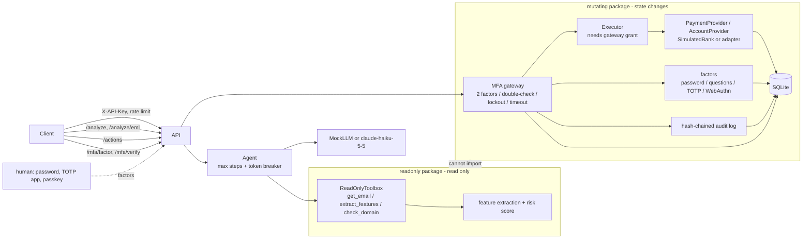

# Reference

Features, architecture, commands, settings, MFA factors, API and mailbox connectors. The overview and the design principles are in the [README](../README.md).

## Features

1. **Hard read/write isolation.** Everything that analyzes mail lives in `phishguard/readonly/`. Everything that can change state lives in `phishguard/mutating/`. The LLM is only ever given read-only tools, and the read-only side cannot import the mutating side. Tests prove it.
2. **Multi-factor enforcement gateway.** Actions touching funds, account changes or invoices are suspended in `mutating/gateway.py` and released only after **two different factors** pass (password, security questions, TOTP, passkey/WebAuthn; at least one must not be a knowledge factor), each checked against the echoed action digest, with timeout, attempt limits and lockout. Nothing the LLM, the email or the request body says can skip this.
3. **Explainable scoring on real mail.** Raw RFC 822 / `.eml` input (multipart, HTML, attachments). Every feature reports its contribution in score points, and the contributions add up to the final score, so an analyst sees *why* a mail scored 68%.
4. **Red team in a sandbox, with fixes.** 94 attack payloads (YAML) run against the API in a locked-down container pair or in-process; every attack is followed by invariant checks (MFA never bypassed, SQL never rewritten, no crash). The suite found 11 real problems, all fixed with regression tests.
5. **Self-improvement that cannot touch security code.** `redteam/improve.py` mines missed phishing and drafts rule proposals for a human; patches that touch the MFA gateway are refused by code.
6. **Payments behind open interfaces.** Approved actions go to a `PaymentProvider` / `AccountProvider`. The default `SimulatedBank` has balances, daily and per-transfer limits, idempotency and a cooling-off period for new or changed bank details; documented stubs show where a bank (ISO 20022), Stripe, Xero or MYOB adapter plugs in ([docs/PAYMENTS_INTEGRATION.md](PAYMENTS_INTEGRATION.md)).
7. **Hybrid rules + LLM to save money.** Rules handle clear-cut mail for free; only the gray zone (score 20-50, around the default threshold of 35) is sent to the LLM. `evaluate.py` measures the trade-off side by side.
8. **Mailbox connectors.** Gmail / Google Workspace (Gmail API), Microsoft 365 / Outlook.com (Graph) and any IMAP-over-TLS mailbox can be scanned incrementally with read-only credentials. Quarantine, labels and warning banners are a separate, opt-in write credential behind the same MFA gateway (single-message quarantine/junk/label/banner run directly; delete, release and bulk actions wait for two factors). See [Mailbox connectors](#mailbox-connectors) and [docs/MAILBOX_SETUP.md](MAILBOX_SETUP.md).

Hardening by area:

| Area | What was added |
|---|---|
| Detection | `.eml` parser; trusted `Authentication-Results` (SPF/DKIM/DMARC); From vs Reply-To / Return-Path; display-name brand spoofing; look-alike domains by edit distance, homoglyphs and punycode; link text vs real `href`; dangerous attachments (`.html`, `.iso`, `.lnk`, macro documents) |
| MFA | Two distinct factors per action: password (argon2id, per-user lockout), security questions (hashed, random sticky subset, rate limited), TOTP (`pyotp`, one use per window), WebAuthn/passkeys (`py_webauthn`, user verification required, challenge bound to the action digest, sign counter); 5 consecutive failures lock the operation; each factor audited |
| Payments | `PaymentProvider`/`AccountProvider` interfaces; `SimulatedBank` with limits, cooling-off, idempotency, history (SQLite); adapter stubs for ISO 20022, Stripe, Xero, MYOB, identity providers |
| Audit | Append-only SHA-256 hash chain, `verify_chain()`, tamper tests for edit / delete / reorder / re-hash, in memory and in SQLite |
| API | `X-API-Key` auth (constant-time), fail-closed when no keys are configured; per-key rate limit; pending MFA, audit, TOTP and lockouts persisted in SQLite (`sqlite3`, no ORM) |
| Evaluation | `rules` / `llm` / `hybrid` modes; accuracy, precision, recall, F1, latency, cost per 1k mails |

## Architecture



```
phishguard/
├── api.py        FastAPI: /analyze /analyze/eml /actions /mfa/enroll /mfa/verify /audit/verify /health
├── routes/       /mfa/factor, /mfa/challenge, enrollment, read-only /payments/*, /demo/webauthn approval center
├── security.py   API key auth (constant time), rate limiter, body size limit
├── agent.py      read-only agent loop with step/token breakers
├── config.py     settings; API key from environment only (mfa_config.py: factors, policy, payments)
├── llm/          base, mock (rule-based), anthropic_client
├── readonly/     eml parser, features, explainable scoring, read-only tools
├── connectors/   READ-ONLY mailbox connectors: gmail, graph, imap (+ presets), oauth, http (backoff),
│                 secrets (redaction, 0600 token store), state (checkpoints), scanner, worker, webhooks
├── mutating/     policy, gateway, factors (password, questions, totp, webauthn), executor, audit, sqlite store,
│   │             mailbox (quarantine / junk / label / banner / delete / release per provider)
│   └── payments/ provider interfaces, SimulatedBank, adapter stubs
├── mailbox_guard.py  scan loop + sink that submits remediation through the gateway
└── dataset/      synthetic generator, customization tiers, public-corpus and Phishing Pot loaders,
                  metrics, evaluate (rules / llm / hybrid)
redteam/          payloads/*.yaml, runner, virtual WebAuthn authenticator, docker-compose sandbox, improve.py, report.md
proposals/        human-review drafts written by improve.py
scripts/          check_email.py, scan_mailbox.py, download_datasets.py, eval_breakdown.py,
                  error_analysis.py, calibrate.py, smoke_real_api.py
examples/         defense_walkthrough.py (self-running demo), run_demo.sh, curl_demo.sh, demo_client.py
tests/  docs/
```

## Terminal demo (`examples/run_demo.sh`)

Real output of `bash examples/run_demo.sh` (MockLLM, API key auth on, SQLite persistence, two-factor policy, MFA timeout 5 s). The passkey in this script is the software authenticator from `redteam/`; for a real Touch ID prompt see [Try the two-factor flow on a Mac](#try-the-two-factor-flow-on-a-mac). Also see `examples/curl_demo.sh`.

```text
== 0. no API key is refused
<- HTTP 401 {'detail': 'missing or invalid API key'}

== 1. analyze phishing email
<- risk=96.7% is_phishing=True
   top contributions: lookalike_domain +22.6; auth_fail +19.7; reply_to_mismatch +12.2; low_reputation +12.2

== 2. alice enrolled four factors (admin key)
<- HTTP 200 {'user': 'alice', 'enrolled': ['password', 'security_questions', 'totp', 'webauthn'], 'policy': {'mode': 'multi_factor', 'required': 2, 'non_knowledge_required': True}, 'can_approve': True}

== 3. transfer_funds 50,000 AUD is suspended by the MFA gateway
<- HTTP 202 {'status': 'pending_mfa', 'confirm_digest': 'ec8da7e44b5dd2bb', 'factors_available': ['password', 'security_questions', 'totp', 'webauthn'], 'mfa_policy': {'mode': 'multi_factor', 'required': 2, 'non_knowledge_required': True}}

== 4. wrong password is rejected
<- HTTP 403 {'detail': {'error': 'verification failed (bad_password)', 'attempts_left': 2}}

== 5. right password: still HELD (1 of 2 factors)
<- HTTP 202 {'status': 'pending_mfa', 'pending_id': 'ZTkEEEOafHcoYNdg', 'accepted': 'password', 'factors_satisfied': ['password'], 'factors_remaining': 1, 'needs_non_knowledge': True, 'factors_available': ['security_questions', 'totp', 'webauthn'], 'next': 'one more factor required, and it must be totp or webauthn (two knowledge factors are not enough)'}

== 6. + security questions: still HELD (two knowledge factors are not enough)
<- HTTP 202 {'status': 'pending_mfa', 'pending_id': 'ZTkEEEOafHcoYNdg', 'accepted': 'security_questions', 'factors_satisfied': ['password', 'security_questions'], 'factors_remaining': 1, 'needs_non_knowledge': True, 'factors_available': ['totp', 'webauthn'], 'next': 'one more factor required, and it must be totp or webauthn (two knowledge factors are not enough)'}

== 7. + TOTP code from the authenticator app: RELEASED
<- HTTP 200 {'status': 'executed'}
   tx_9b4d92e7aeab751e: 50000.00 AUD -> ACME-VENDOR, idempotency key pg-ZTkEEEOafHcoYNdg

== 8. second transfer: password + passkey (challenge bound to this action): RELEASED
<- HTTP 200 {'status': 'executed', 'factors': ['password', 'webauthn']}

==    replaying that passkey assertion is refused
<- HTTP 409 {'detail': '2IMMh-lTLm6Cf-nX is already executed'}

== 9. 'our bank details changed' + urgent invoice: MFA passes, bank holds it (cooling-off)
<- HTTP 422 {'status': 'declined', 'result': {'ok': False, 'error': 'cooling_off', 'message': 'payee ACME-VENDOR details changed recently; payments held until cooling-off ends', 'retryable': False, 'payee_id': 'ACME-VENDOR', 'until': 1793839439.662009, 'effect_index': 3}, 'factors': ['password', 'webauthn']}

== 10. another transfer, then wait 6.0s without approving

==     late password after timeout is rejected
<- HTTP 410 {'detail': 'MFA timed out; action rejected'}

== 11. balances
<- HTTP 200 {'provider': 'simulated', 'accounts': [{'id': 'OPERATING', 'name': 'Operating account', 'currency': 'AUD', 'balance': '198800.00', 'daily_limit': '100000.00', 'daily_used': '51200.00'}, {'id': 'PAYROLL', 'name': 'Payroll account', 'currency': 'AUD', 'balance': '80000.00', 'daily_limit': '100000.00', 'daily_used': '0.00'}]}

== 12. audit hash chain verifies
<- HTTP 200 {'chain_ok': True, 'first_broken': None}
```

## Commands

```bash
pip install -r requirements.txt
python -m pytest                                          # MockLLM only, no network
python scripts/check_email.py tests/fixtures/             # score saved .eml files, no server needed
python -m phishguard.dataset.evaluate --n 200 --seed 42   # rules-mode comparison table
python scripts/calibrate.py --help                        # real-corpus weight calibration (dev split only)
PHISHGUARD_API_KEYS=dev-key uvicorn phishguard.api:get_app --factory --port 8000
bash examples/run_demo.sh                                 # end-to-end demo
docker build -t phishguard . && docker run -p 8000:8000 -e PHISHGUARD_API_KEYS=change-me phishguard  # non-root
```

### Check a saved email (no server)

`scripts/check_email.py` scores `.eml` files in-process. It uses the same parser, agent and result format as `POST /analyze/eml`, and the same `PHISHGUARD_*` settings (`PHISHGUARD_THRESHOLD`, `PHISHGUARD_TRUSTED_DOMAINS`, `PHISHGUARD_EXECUTIVES`, `PHISHGUARD_AUTHSERV_ID`; `PHISHGUARD_LLM_MODE=mock` by default, so nothing leaves the machine).

```bash
python scripts/check_email.py mail.eml                    # one file: sender, subject, risk, verdict, top reasons
python scripts/check_email.py inbox_export/               # every .eml in a folder
python scripts/check_email.py mail.eml --json             # the full API-style JSON result
```

Each mail prints its risk, the threshold, the verdict and up to eight scoring reasons with their points; the last line counts the flagged mails (on the ten test fixtures: `7/10 flagged as phishing (mode: mock)`). A file the parser refuses (too large, too many MIME parts) is reported as rejected and the run continues. Exit code 2 means no `.eml` file was found. It only reads: there is no mailbox access and no remediation here (that is `scripts/scan_mailbox.py`, see "Mailbox connectors").

| Env var | Default | Meaning |
|---|---|---|
| `PHISHGUARD_LLM_MODE` | `mock` | `anthropic` calls the real API |
| `ANTHROPIC_API_KEY` | none | read only from the environment |
| `PHISHGUARD_MODEL` | `claude-haiku-5-5` | model name |
| `PHISHGUARD_MAX_STEPS` | 6 | max agent iterations |
| `PHISHGUARD_MAX_TOKENS` | 8000 | token budget per request |
| `PHISHGUARD_MFA_TIMEOUT` | 120 | seconds before auto-reject |
| `PHISHGUARD_AUDIT_LOG` | none | JSONL audit file path |
| `PHISHGUARD_TRUSTED_DOMAINS`, `PHISHGUARD_EXECUTIVES` | `acme-corp.com`, empty | for lookalike and impersonation checks |
| `PHISHGUARD_API_KEYS` | none | comma-separated client keys; **required** (server refuses to start without them) |
| `PHISHGUARD_ALLOW_NO_AUTH` | unset | `1` disables auth; local development only |
| `PHISHGUARD_THRESHOLD` | 35 | risk score at which `is_phishing` is true (see [EVALUATION.md](EVALUATION.md#real-data-results) for why 35, not 50) |
| `PHISHGUARD_LLM_MAY_LOWER` | unset | `1` lets the model lower a gray-zone score, within the floor and vetoes in [EVALUATION.md](EVALUATION.md#llm-benign-vote-opt-in-injection-resistant-lowering) |
| `PHISHGUARD_TIMEZONE` | unset | recipient time zone for `off_hours_send` (e.g. `Australia/Brisbane`); unset judges the sender's own `Date` zone |
| `PHISHGUARD_RATE_LIMIT` | 60 | requests per key per minute |
| `PHISHGUARD_DB_PATH` | none | SQLite file for pending MFA, audit, TOTP, lockouts (memory if unset) |
| `PHISHGUARD_MFA_MAX_ATTEMPTS` | 3 | bad codes before one pending action is rejected |
| `PHISHGUARD_MFA_LOCKOUT_THRESHOLD`, `_SECONDS` | 5, 900 | consecutive failures that lock an operation, and for how long |
| `PHISHGUARD_AUTHSERV_ID` | none | trust only `Authentication-Results` from this MTA (e.g. `mx.acme-corp.com`) |
| `PHISHGUARD_ADMIN_KEYS` | none | keys allowed to call `/mfa/enroll` (enrollment is refused without one) |
| `PHISHGUARD_OPEN_ENROLLMENT` | unset | `1` lets any client key enroll; development only |
| `PHISHGUARD_MAX_BODY_BYTES` | 3000000 | request body cap (413) |
| `PHISHGUARD_MFA_REQUIRED_FACTORS` | 2 | distinct factors needed to release an action (2-4) |
| `PHISHGUARD_MFA_ALLOW_KNOWLEDGE_ONLY` | unset | `1` lets password + security questions release an action (not recommended) |
| `PHISHGUARD_MFA_DEV_SINGLE_FACTOR` | unset | `1` restores the old one-code flow (TOTP or console code); development only |
| `PHISHGUARD_PASSWORD_LOCKOUT_THRESHOLD`, `_SECONDS` | 5, 900 | wrong passwords per user before the password locks, and for how long |
| `PHISHGUARD_QUESTIONS_PER_CHALLENGE`, `PHISHGUARD_QUESTIONS_MAX_FAILURES` | 2, 3 | questions asked per challenge; failed challenges per user per hour |
| `PHISHGUARD_WEBAUTHN_RP_ID`, `PHISHGUARD_WEBAUTHN_ORIGINS`, `PHISHGUARD_WEBAUTHN_RP_NAME` | `localhost`, `http://localhost:8000`, `PhishGuard` | passkey relying party; the origin must match the URL in the browser exactly |
| `PHISHGUARD_PAYMENT_PROVIDER` | `simulated` | `simulated`, or a stub: `iso20022`, `stripe`, `xero`, `myob` (they decline with `provider_not_implemented`) |
| `PHISHGUARD_COOLING_OFF_SECONDS` | 86400 | no payments to new or changed bank details for this long |
| `PHISHGUARD_DAILY_LIMIT`, `PHISHGUARD_PER_TRANSFER_LIMIT` | 100000.00, 60000.00 | simulated bank limits (per account per UTC day; per transfer) |
| `PHISHGUARD_CURRENCY`, `PHISHGUARD_PAYMENTS_SEED` | `AUD`, `1` | account currency; seed demo accounts/payees/invoices into an empty bank |

### MFA: two factors per sensitive action

A suspended action is released after **two different methods** pass (`PHISHGUARD_MFA_REQUIRED_FACTORS`), and by default at least one of them must be TOTP or a passkey:

| Method | Category | How it is checked |
|---|---|---|
| `password` | knowledge | argon2id hash, constant-time verify, 5 wrong tries lock the password for that user (15 min) |
| `security_questions` | knowledge | answers normalized and argon2id-hashed; random subset per challenge (sticky until answered); 3 failed challenges/hour per user |
| `totp` | possession | authenticator app code, one use per 30 s window |
| `webauthn` | possession + on-device biometric/PIN | passkey assertion with `userVerification: "required"`; challenge bound to this action's digest, single use; origin, RP ID, sign counter verified |

Why password + security questions isn't enough: both are "something you know", so one phishing form can collect both; NIST SP 800-63B counts a memorized secret as one factor and doesn't accept knowledge-based questions as an authenticator. `PHISHGUARD_MFA_ALLOW_KNOWLEDGE_ONLY=1` overrides this; see [DESIGN.md](DESIGN.md) Q52. Every attempt goes into the audit chain as method + result, never the secret. All methods share the per-action attempt limit and the per-operation lockout, and only a full approval resets the lockout counter.

Enrollment needs an admin key (or `PHISHGUARD_OPEN_ENROLLMENT=1` in development). A user who already has two factors can add another without an admin: submit `add_mfa_factor {"method": "webauthn"}`, approve it, and send the returned single-use `enrollment_token` as `X-Enrollment-Token`. Users with too few factors are still suspended (`approvable: false`) and can't be approved; there is no console-code fallback unless `PHISHGUARD_MFA_DEV_SINGLE_FACTOR=1` (development only).

### Try the two-factor flow on a Mac

1. Start the server (Python 3.11+):
   ```bash
   pip install -r requirements.txt
   PHISHGUARD_API_KEYS=dev-key PHISHGUARD_ADMIN_KEYS=dev-admin PHISHGUARD_DB_PATH=/tmp/pg.db \
     uvicorn phishguard.api:get_app --factory --port 8000
   ```
2. Open **http://localhost:8000/demo/webauthn** in Safari or Chrome (`localhost`, not `127.0.0.1`: browsers refuse an IP as a passkey RP ID; for another port set `PHISHGUARD_WEBAUTHN_ORIGINS=http://localhost:<port>`).
3. Click the gear (top right), enter API key `dev-key`, admin key `dev-admin` and a user name, and click **Connect**. The keys are kept in the page's memory only, so a reload asks again.
4. Under **Account security**, **Set** a password, then **Register** a passkey and confirm with Touch ID (or iCloud Keychain / a phone).
5. In the **Action Center**, click **Ask agent to transfer**. The approval card on the right shows the held transfer (`pending_mfa`), the payee, the action digest and a two-minute countdown.
6. Click **Approve with Passkey (Touch ID)**, then type the password and click **Approve**. The card shows the executed transfer with its transaction id, and **Balances** shows the debit. One factor alone does not release it, a wrong password leaves two attempts, and letting the countdown run out rejects the transfer.
7. **Audit log → Verify hash chain** checks the tamper-evident log.

The same in a terminal without a browser: `bash examples/run_demo.sh` (software passkey + TOTP via `pyotp`), or `examples/curl_demo.sh` with your own authenticator app.

### Real API smoke test

Not part of pytest. Needs a key; exits quietly without one:

```bash
ANTHROPIC_API_KEY=... python scripts/smoke_real_api.py --price-in <USD/MTok> --price-out <USD/MTok>
```

It analyzes 5 sample emails (2 benign, 3 BEC or payment-chasing) and prints score, latency and tokens. Prices are not hard-coded, so supply current ones to get a cost upper bound. **Status: not run yet.** No `ANTHROPIC_API_KEY` was available when this was written, so there are no real-API results.

## API

All routes except `/health` need header `X-API-Key`. Missing or wrong key: 401; over the limit: 429 with `Retry-After`.

| Endpoint | Description |
|---|---|
| `GET /health` | status, version, mode, model, auth and persistence mode |
| `POST /analyze` | body `{"email": {...}}`; returns `risk_percent`, `is_phishing` (risk >= `threshold`, default 35), `threshold`, `features[{name, weight, evidence, contribution}]` sorted by contribution, `explanation`, `steps_used`, `tokens_used`, `circuit_break` |
| `POST /analyze/eml` | body `{"raw": "<RFC 822 text>"}` (max 2 MB, else 413); same output plus `parsed` (from, reply-to, return-path, SPF/DKIM/DMARC, attachment metadata) |
| `POST /actions` | body `{action_type, params, requested_by, reason}`; 200 executed, or 202 `pending_mfa` with `pending_id`, `confirm_digest`, `mfa_policy`, `factors_available`, `approvable`; 400 unknown action; 423 operation locked |
| `POST /mfa/enroll` | TOTP; admin key or `X-Enrollment-Token`; body `{user}`; returns `otpauth_uri` (render as QR); 403 without, 409 if already enrolled |
| `POST /mfa/verify` | body `{pending_id, code, confirm_digest}`: the TOTP factor. 202 accepted but more factors needed, 200 executed, 422 declined by the provider, 403 failed (`attempts_left`), 400 TOTP not enrolled, 404 unknown, 409 finished, 410 timed out, 423 locked |
| `POST /mfa/challenge` | body `{pending_id, confirm_digest, method}`; `webauthn` returns `publicKey` options (challenge bound to the action), `security_questions` returns the questions to answer |
| `POST /mfa/factor` | body `{pending_id, confirm_digest, method, response}`; `response` is `{password}`, `{code}`, `{answers: {id: answer}}` or `{credential}` (WebAuthn JSON). Same status codes as `/mfa/verify`; 409 if this method already passed; 423 also when a method's own limiter is active |
| `GET /mfa/pending/{id}` | state, factors satisfied / remaining / available |
| `GET /mfa/factors/{user}` | enrolled methods, policy, `can_approve` |
| `POST /mfa/enroll/password` | admin key or `X-Enrollment-Token`; body `{user, password}`; 409 already set, 422 weak |
| `POST /mfa/enroll/questions` | admin key or token; body `{user, questions: [{question, answer}]}` (3-10) |
| `POST /mfa/webauthn/register/options`, `/verify` | options: admin key or token, body `{user}`; verify: body `{user, credential}` (bound by the single-use registration challenge) |
| `GET /payments/accounts`, `/payments/accounts/{id}/transactions`, `/payments/transactions/{id}`, `/payments/payees/{id}` | read-only balances, history, status, payee (masked account, cooling-off) |
| `GET /demo/webauthn` | no key; browser demo page, served only when the RP ID is `localhost` |
| `GET /audit/verify` | `{chain_ok, first_broken}` |

Always-MFA actions (two factors): `transfer_funds`, `pay_invoice`, `approve_invoice`, `change_bank_details`, `change_account_email`, `reset_password`, `change_account_settings`, `add_mfa_factor`, `delete_email`, `release_from_quarantine`. Mailbox actions on more than 10 messages at once also need MFA. Others run directly unless their params or reason mention money or accounts. Payment params: `transfer_funds {amount, payee_id, from_account?, currency?, reference?}`, `pay_invoice` / `approve_invoice {invoice_id}`, `change_bank_details {payee_id, account_name, bsb + account_number | iban, bic?}`. The simulated bank is seeded with accounts `OPERATING` / `PAYROLL`, payees `ACME-VENDOR` / `GLOBEX` and invoices `INV-1001` / `INV-1002`.

## Mailbox connectors

PhishGuard can pull mail from real mailboxes instead of waiting for `.eml` uploads. Step-by-step setup for non-experts (Google Cloud OAuth client, Azure app registration, IMAP app passwords) is in **[docs/MAILBOX_SETUP.md](MAILBOX_SETUP.md)**.

```bash
python scripts/scan_mailbox.py --provider gmail --authorize          # one-time sign-in, token stored outside the repo (0600)
python scripts/scan_mailbox.py --provider gmail --last 20            # scan the last 20 messages, print verdicts
python -m phishguard.connectors.worker --provider graph --interval 60   # poll, one JSON verdict per new message
python -m phishguard.mailbox_guard --provider imap --action quarantine  # opt-in: act on verdicts via the MFA gateway
```

| Provider | API and read scope | Auth | Incremental cursor |
|---|---|---|---|
| Gmail / Google Workspace | Gmail API, `gmail.readonly`, `messages.get?format=raw` | Desktop OAuth (loopback + PKCE), or Workspace service account with domain-wide delegation | `historyId` via `history.list` |
| Microsoft 365 / Outlook.com | Graph, `Mail.Read`, `/messages/{id}/$value` | Device code (delegated), or client credentials (app-only) | messages `delta` link, immutable IDs |
| IMAP (iCloud, Yahoo, AOL, Fastmail, QQ, 163/126, Zoho, GMX, Yandex, ...) | IMAP4 over TLS, `EXAMINE` + `BODY.PEEK[]` | App password, or XOAUTH2 (Gmail / Outlook) | `UIDVALIDITY:UID` |

How it fits the architecture:

- `phishguard/connectors/` is read-side: it lists ids and downloads raw RFC 822 bytes, which go through the same `parse_eml` + `PhishingAgent.analyze` path as `/analyze/eml` (the 2 MB `EmlTooLarge` limit applies before download where the provider reports a size, and during streaming otherwise). It never imports `mutating/`. Tests check this with AST scans, an import-closure check, a run with `mutating` imports blocked, a scan for write verbs, and a runtime check that a full Gmail + Graph scan sends only GETs (plus token endpoints and read-scoped push subscriptions).
- A read credential that also grants write scopes (`gmail.modify`, `Mail.ReadWrite`, ...) is refused. Write access is a separate credential in a separate token file, loaded only by `mutating/mailbox.py`, and only reachable as Executor handlers behind a gateway grant.
- Scans are incremental and idempotent: a SQLite checkpoint store keeps the provider cursor (saved only after a round completes), every scanned id, and the content SHA-256. A message is never scanned or remediated twice, even after a crash, an expired cursor, IMAP renumbering or overlapping push notifications.
- 429/503 (and Gmail's rate-limit 403s) back off honoring `Retry-After`; a 401 triggers one token refresh. Bearer tokens are sent only to the provider's own https hosts, so a tampered paging link can't leak them.
- Secrets come only from environment variables or files outside the repo (refused if group/world readable). They are redacted from logs, output, the state DB and the audit log, and tests check all of these.
- Optional push: Gmail via Pub/Sub (Google-signed JWT verified) and Graph change notifications (`validationToken` handshake, `clientState`), served by the worker's own small server, not by `api.py`. A notification only wakes the poller.

**Status:** Gmail has been run read-only against one real personal mailbox (2026-11-14, see [EVALUATION.md](EVALUATION.md#real-mailbox-results-one-personal-gmail-inbox)); Microsoft Graph and IMAP are still tested only against offline fakes (`httpx.MockTransport`, a real-socket fake IMAP server over TLS). See [LIMITATIONS.md](LIMITATIONS.md).
